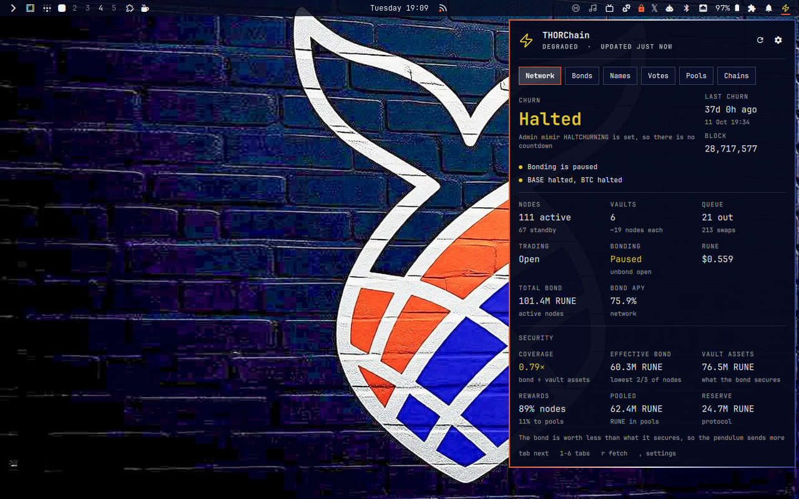

# omathor

Omarchy plugin that keeps an eye on [THORChain](https://thorchain.org): the
network's health, the churn, halted chains, the nodes you bond to, your
THORNames, node votes and pools. One bolt on the bar, coloured by how things
are.



It is read-only. It never signs or sends anything and needs no key and no
account. Fetching never sends your bond addresses: bonds are found in the
public node list, which is fetched whole. The one exception is looking up
which THORNames an address owns, which you trigger yourself (see
[THORNames](#thornames)).

Omathor is not made by or affiliated with THORChain or any of its
contributors.

## Requirements

- Omarchy **Quattro** (v4.5+) with the plugin runtime
- `curl` and `jq`, both in the Arch repositories. The plugin never installs
  packages itself; if one is missing, `install.sh` names it.

## Install

```sh
omarchy plugin add https://github.com/sette7blo/omathor.git --enable
```

The first time the plugin loads, it links the `omathor` command and a
launcher entry. Click the bolt, open the settings (the gear, or `,`) and add
the addresses you bond from.

To update: `omarchy plugin update io.github.sette7blo.omathor`.

From a clone instead, `./install.sh` does the same. `--no-enable` links
everything but leaves the bar widget for you to enable.

## What gets installed

| Location | What |
|---|---|
| `~/.config/omarchy/plugins/io.github.sette7blo.omathor` | Plugin dir |
| `~/.local/bin/omathor` | Command line tool (symlink) |
| `~/.local/share/applications/omathor.desktop` | Launcher entry, opens the panel |
| `~/.local/state/omarchy/omathor/snapshot.json` | The last fetch, trimmed to what the plugin reads |
| `~/.local/state/omarchy/omathor/summary.json` | What the panel shows, for the `omathor` command |

Settings (addresses, bar, currency, notifications, endpoints) are kept in
the widget's own entry in `~/.config/omarchy/shell.json`.

## Bar

A bolt, coloured by health:

| Colour | Means |
|---|---|
| Your theme's foreground | All well |
| Gold | The network is degraded: churning or bonding halted, a chain halted or paused, or one of your nodes is jailed, on standby, behind on version, or first in line to churn out |
| Your theme's urgent colour | THORChain stopped making blocks, or one of your nodes is leaving, forced out or disabled |
| Dimmed | No fresh data (nothing fetched in 15 minutes) |

By default it shows only the colour. The settings can add the time to the
next churn, or what your bonds have earned since the last churn, in RUNE or
USD. Left click opens the panel, right click fetches now.

## Panel

Six tabs:

- **Network**: what needs attention, the churn (next, last, or why there is
  no countdown), block height, trading and bonding, vaults, the outbound
  queue, node counts, total bond, RUNE price and the network's bond APY.
  Then **Security**: the effective bond against the assets in the vaults
  (the incentive pendulum), how the rewards split between nodes and pools,
  the RUNE pooled and the reserve. Then **Upgrade**: how many active nodes
  run the newest version (the network moves to it only once all of them
  do), the version new nodes need to join and since when, and any chain
  upgrade proposal with its approval and height. About 1.5 days after that
  required version is raised (`ChurnOutForLowVersionBlocks`), each churn
  can eject active nodes still below it (up to
  `MAXNODETOCHURNOUTFORLOWVERSION`). A node of yours below it shows the time
  left to upgrade, then turns red once it can be churned out for it.
- **Bonds**: each address and each node it bonds to: status, your bond
  and share of the node, the operator fee, what you have earned since the
  last churn and the APY that works out to, slash points against the
  median, and where the node stands on the three things a churn ejects for
  (oldest, worst slash points, lowest bond). Enter or a click opens the node
  on thorchain.net.
- **Names**: a card per THORName (see [THORNames](#thornames)).
- **Votes**: node votes on mimir settings closest to passing (see
  [Votes](#votes)).
- **Pools**: each pool, deepest first: whether it can be swapped now (staged
  pools are not open yet, and a halted or paused chain blocks its pools),
  liquidity, the 2% depth (about how big a swap moves the price by 2%), 24h
  volume and APR. The top 12, with a button for the rest. From Midgard, with
  the node list.
- **Chains**: each connected chain, whether it is halted or paused, the
  last block THORChain observed on it, and its gas rate.

Keys: `tab` or `1` to `6` switch tabs, `j` `k` select a node, `enter` opens
it in the explorer, `r` fetches now, `,` opens the settings, `esc` closes.

## Churn

The churn line follows the chain's own rules rather than a countdown alone:

- **Blocked** when THORChain has made no block for three minutes.
- **Halted** while the admin mimir `HALTCHURNING` is set. There is no
  countdown then, whatever the interval says.
- **Churning** while vaults migrate to the new node set.
- **Due** once the interval has passed; the network retries until it
  succeeds.
- Otherwise the time to the next churn, from the last churn's block, the
  interval (mimir `CHURNINTERVAL`), and the measured block time.

## THORNames

Each name gets a card: when it expires, the affiliate fees waiting to be paid
out (with a bar towards the payout threshold and the asset they are paid in),
the owner, and the address it points to on each chain. A name turns the bolt
gold with 30 days left and red with 7.

There is no list of every name to search locally, so names work differently
from bonds:

- **Finding them.** Each bond address is sent to Midgard once, when it is
  added (or the first time the plugin runs with it), to ask which names it
  owns (`/v2/thorname/owner/<address>`). Nothing else sends an address, and
  never on a timer. Remove an address and add it back to search it again.
  Any other name can be added by hand.
- **Reading them.** Each name is asked for by name
  (`/thorchain/thorname/<name>`) and what comes back is saved. The expiry
  counts down from the saved block, so it stays right without asking again.
  The fees waiting change with every swap, so the card says when they were
  read.
- **Refreshing them.** Manual by default: the refresh icon on a card reads
  that name again. Daily or Weekly in the settings reads them on that
  schedule instead. Only names are sent, never addresses, but a name leads to
  its owner, so whoever runs the endpoint can link the two.

## Votes

Node operators vote on mimir settings. THORNode counts only active nodes'
votes, one per node, and a setting takes the value two thirds of them agree
on. The tab shows the votes closest to that line, each with its count, what
it would set, and how each node you bond to voted. ADR votes carry the ADR's
title, status and first sentence, read from THORNode's repository on GitLab
(the file list at most once a day, a document only when it changed); a click
opens the document. Halt and pause settings are operational, decided by the
most votes instead, so they are left out. Below, the settings now in force
by node vote.

The votes are read only while the tab is open, at most every 30 minutes (`r`
reads them now). Your node addresses are matched on this computer; they are
not sent.

## Rewards and APY

A node's reward since the last churn is THORNode's `current_award`. Your
part is that award after the operator fee, times your share of the node's
bond; an operator also gets the fee on the whole award. The APY annualises
that over the time since the churn, with the period floored at 5% of the
churn interval so it does not spike right after a churn. It is an estimate
of the current rate, not a promise.

## Command line

```
omathor              status in a few lines
omathor network      the Network tab
omathor bond         the Bonds tab
omathor pools        the Pools tab
omathor chains       the Chains tab
omathor names        the Names tab
omathor names refresh [name ...]
                     read the names again
omathor votes        the Votes tab
omathor votes fetch [node ...]
                     read the votes (nodes are matched locally)
omathor names find <thor1...>
                     which names an address owns (sends the address)
omathor refresh      fetch now, then print the status
omathor panel [tab]  open or close the panel; with a tab (network, bonds,
                     names, votes, pools, chains), open it on that tab
omathor --json ...   the same as JSON
```

A list of nodes, names or addresses can also be given as `-`, followed by one
line of them on stdin, so it does not show in the process list:

```sh
echo thor1... | omathor names find -
```

The panel's service computes the summary, so the command prints what the
panel shows. The plugin has to be loaded for the summary to update.

## Data and privacy

Every two minutes (only while the panel is open, if you turn background
refresh off) the service runs `omathor fetch`, which reads:

- THORNode at `gateway.liquify.com`, falling back to
  `public-thornode.nativeswap.io`: the last block, mimir, inbound
  addresses, Asgard vaults, network, queue and version. Every 30 minutes
  (every 10 while the panel is open or the bar shows the reward) also the
  node list, the constants and the upgrade proposals.
- The THORChain RPC at `gateway.liquify.com`, falling back to
  `public-thorchain-rpc.nativeswap.io`: the latest block header, for the
  height and the time. With your own THORNode set, the block comes from it
  instead.
- Midgard at `gateway.liquify.com`, with the node list: the churn history
  (for the date of the last churn), the network's bond APY, the reward
  split and the pools.

Responses are compressed. That comes to about 40 MB a day with the panel
closed, and about 90 MB if it stayed open all day.

Requests are https, time out, are capped in size and do not follow
redirects. They ignore your curl configuration (`~/.curlrc`), so a setting
there cannot make them follow a redirect or skip the certificate check.
Responses are trimmed to the fields the plugin uses before they
are saved, and every value is cleaned before it is shown. THORNames are read
only as described under [THORNames](#thornames). Bond and node addresses and
THORNames never appear in a process's arguments, where other accounts on
the computer could read them: the panel hands them to `omathor` on stdin,
request addresses reach `curl` in its configuration on stdin, and
notifications go to the notification service over D-Bus rather than through
`notify-send`'s arguments (if that fails, a notice that names nothing is sent
instead). An address or THORName removed from the settings is not looked up
any more, and a lookup that was already running for it leaves no record
behind. Your own THORNode
and Midgard can be set in the settings: https, or plain http only to this
computer or a private network.

## Uninstall

`omarchy plugin remove` deletes the plugin folder only. It does not run the
plugin's uninstaller, so run that first, from the plugin folder:

```sh
~/.config/omarchy/plugins/io.github.sette7blo.omathor/uninstall.sh
omarchy plugin remove io.github.sette7blo.omathor
```

From a clone, run `./uninstall.sh` in the clone instead.

Run it from your desktop session, with the Omarchy shell running. The
uninstaller first turns the plugin off and checks with the shell that it is
off, which drops its bar entry and with it the settings (your bond
addresses, THORNames, endpoints); if it cannot confirm that, it removes
nothing and says so. It then waits for any omathor command still running to
finish (up to 90 seconds; it stops no process); if one is still running,
nothing is removed and it says so. Only then does it remove the `omathor`
command and launcher links that point into the plugin and delete everything
omathor saved in `~/.local/state/omarchy/omathor/`, and it reports success
only if nothing wrote that folder again. Whenever it stops early, run it
again. It leaves a small lock file and the time of the uninstall in
`$XDG_RUNTIME_DIR/omathor/`, which is emptied when you log out or restart; a
command that was waiting for the uninstall exits without writing anything.
The folder holds:

| File | What it holds |
|---|---|
| `snapshot.json` | The last network and node data fetched |
| `summary.json` | Your bond addresses with their bonds and rewards |
| `names.json` | Your THORNames, and which addresses were searched for names |
| `votes.json`, `adrs.json` | Node votes and ADR titles |
| `.fetch.*` | Work folders of a refresh that was cut off, for example by a shell restart |

If the plugin was already removed without it, delete that folder and the two
links by hand:

```sh
rm -rf ~/.local/state/omarchy/omathor
rm -f ~/.local/bin/omathor ~/.local/share/applications/omathor.desktop
```

Check first that the two links are omathor's (`ls -l` shows where they
point); the installer never replaces a command or launcher of that name that
belongs to something else.

## License

MIT
